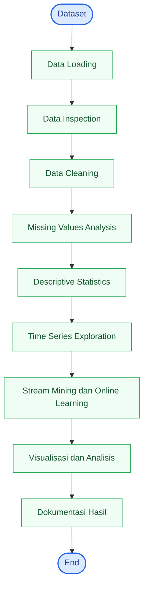

# Stream and Time Series Mining

Repository ini berisi notebook dan dokumentasi analisis data transaksi penjualan menggunakan pendekatan *Time Series Mining* dan *Stream Mining*. Proyek ini memanfaatkan dataset **Amazon Sales and Trading Insights Dataset 2024** yang diperoleh dari Kaggle untuk mengeksplorasi karakteristik data, pola penjualan berdasarkan waktu, serta konsep pemrosesan data secara bertahap menggunakan pendekatan *online learning* dengan pustaka `river`.

## Gambaran Umum Proyek

Data transaksi penjualan memiliki karakteristik yang dapat dianalisis berdasarkan urutan waktu. Melalui analisis tersebut, pola, tren, dan perubahan aktivitas penjualan dapat dieksplorasi untuk memperoleh pemahaman yang lebih baik terhadap perilaku data.

Proyek ini berfokus pada eksplorasi data transaksi penjualan melalui dua pendekatan utama, yaitu *Time Series Mining* dan *Stream Mining*.

*Time Series Mining* digunakan untuk mengeksplorasi pola data berdasarkan dimensi waktu, sedangkan *Stream Mining* berkaitan dengan pemrosesan data yang datang secara berkelanjutan atau bertahap. Pustaka `river` digunakan untuk mendukung eksperimen pemrosesan data secara *incremental* melalui pendekatan *online learning*.

## Tujuan Analisis

- Memahami karakteristik dataset transaksi penjualan yang memiliki dimensi waktu.
- Melakukan proses pembersihan dan persiapan data sebelum analisis.
- Mengidentifikasi nilai kosong (*missing values*) dan memeriksa kualitas data.
- Menghasilkan ringkasan statistik deskriptif untuk memahami karakteristik dataset.
- Mengeksplorasi pola dan tren penjualan berdasarkan rentang waktu harian dan bulanan.
- Memahami konsep dasar *Stream Mining* dan *Time Series Mining*.
- Menerapkan penggunaan pustaka `river` untuk mendukung eksperimen pemrosesan data secara bertahap melalui pendekatan *online learning*.

## Dataset

Dataset yang digunakan dalam proyek ini adalah **Amazon Sales and Trading Insights Dataset 2024** yang diperoleh dari Kaggle.

| Komponen | Keterangan |
|---|---|
| Nama Dataset | Amazon Sales and Trading Insights Dataset 2024 |
| Sumber | Kaggle |
| Jenis Data | Data transaksi penjualan |
| Fokus Analisis | Eksplorasi karakteristik data dan pola penjualan berdasarkan waktu |

### Cakupan Pengolahan Dataset

Pengolahan dataset mencakup beberapa tahapan berikut:

- **Data Inspection:** Memeriksa struktur dataset, jumlah baris dan kolom, tipe data, serta karakteristik awal data.
- **Data Cleaning:** Melakukan pemeriksaan dan penanganan data yang diperlukan sebelum analisis.
- **Missing Values Analysis:** Mengidentifikasi keberadaan nilai kosong pada kolom-kolom dataset.
- **Descriptive Statistics:** Menghasilkan ringkasan statistik deskriptif untuk memahami distribusi dan karakteristik data.
- **Time-Based Analysis:** Mengeksplorasi pola penjualan berdasarkan rentang waktu harian dan bulanan.

Dataset tidak disertakan secara langsung dalam repository apabila ukurannya besar atau memiliki ketentuan distribusi tersendiri. Pengguna perlu memperoleh dataset dari sumber aslinya di Kaggle.

## Pendekatan Analisis

### Time Series Mining

*Time Series Mining* merupakan pendekatan analisis terhadap data yang memiliki urutan waktu untuk mengidentifikasi pola, tren, dan perubahan yang terjadi dalam periode tertentu.

Dalam proyek ini, pendekatan tersebut digunakan untuk:

- Mengeksplorasi data transaksi berdasarkan informasi waktu.
- Menganalisis pola penjualan dalam rentang waktu harian.
- Menganalisis pola penjualan dalam rentang waktu bulanan.
- Mengamati perubahan aktivitas penjualan berdasarkan periode pengamatan.

### Stream Mining

*Stream Mining* merupakan pendekatan untuk mengolah dan menganalisis data yang tersedia secara berkelanjutan atau bertahap.

Dalam proyek ini, konsep tersebut dipelajari melalui penggunaan pustaka `river`, yang mendukung pemrosesan data secara *incremental* dan pendekatan *online learning*.

Pendekatan *online learning* memungkinkan model diperbarui secara bertahap ketika menerima data baru, tanpa harus selalu melakukan pelatihan ulang menggunakan keseluruhan dataset.

Implementasi dan eksperimen yang dilakukan mengikuti metode serta tahapan yang tercantum dalam notebook utama.


## Tahapan Pengolahan dan Analisis

Secara umum, proses pengerjaan proyek dilakukan melalui beberapa tahapan pengolahan data, eksplorasi, analisis, hingga dokumentasi hasil. Alur tersebut digambarkan dalam flowchart berikut:



## Cara Menjalankan Notebook

### Menggunakan Google Colab

- Buka repository GitHub proyek ini.
- Pilih file `week6_stream_time_series_mining.ipynb`.
- Unduh notebook atau buka menggunakan Google Colab.
- Pastikan dataset telah tersedia dan dapat diakses oleh Google Colab.
- Sesuaikan lokasi atau path dataset apabila diperlukan.
- Jalankan seluruh sel notebook secara berurutan dari awal hingga akhir.

### Menjalankan Secara Lokal

**Clone repository**

```bash
git clone https://github.com/yanakapardede/stream-time-series-mining.git
```

**Masuk ke direktori proyek**

```bash
cd stream-time-series-mining
```

**Install dependensi**

```bash
pip install -r requirements.txt
```

**Jalankan notebook**

Buka notebook menggunakan Jupyter Notebook atau JupyterLab, kemudian jalankan file:

```text
week6_stream_time_series_mining.ipynb
```

Pastikan dataset sudah tersedia pada direktori kerja dan path dataset telah disesuaikan dengan lingkungan yang digunakan.

## Hasil Analisis

Luaran utama proyek ini berupa notebook yang mendokumentasikan proses pengolahan, eksplorasi, visualisasi, dan eksperimen analisis data.

Dokumentasi hasil pengerjaan mencakup:

- Pemeriksaan struktur dan karakteristik dataset.
- Proses pembersihan data.
- Pemeriksaan nilai kosong (*missing values*).
- Ringkasan statistik deskriptif.
- Eksplorasi pola penjualan berdasarkan periode harian dan bulanan.
- Eksperimen terkait *Stream Mining* dan *Time Series Mining* menggunakan pustaka yang relevan.

Hasil numerik, visualisasi, dan keluaran eksperimen dapat dilihat secara langsung pada notebook utama.

## Kesimpulan

Proyek ini mengeksplorasi data transaksi penjualan dengan memperhatikan karakteristik data berdasarkan waktu serta konsep pemrosesan data secara bertahap.

Melalui pendekatan *Time Series Mining* dan *Stream Mining*, dilakukan proses pengolahan data, analisis pola deret waktu, serta eksperimen pendekatan *online learning* menggunakan pustaka `river`.

Seluruh proses pengerjaan dan eksperimen didokumentasikan dalam notebook sebagai bentuk penerapan teknik analisis data deret waktu dan pemrosesan data *stream*.
